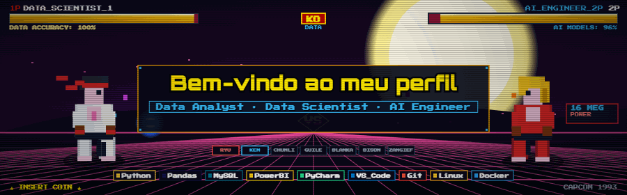

<!-- BANNER CUSTOMIZADO (Certifique-se de que a imagem está na pasta raiz do repositório) -->

# Olá, eu sou o Wendell Costa! 👋

### 👨‍💻 Cientista de Dados e Engenheiro de I.A. em Formação

Sou um entusiasta de tecnologia apaixonado por resolver problemas complexos com dados. Durante a pandemia, atuei como desenvolvedor web e com importação, mas o meu verdadeiro brilho nos olhos sempre foi o universo dos dados e da Inteligência Artificial. Atualmente, busco criar soluções robustas de I.A. e aplicar as melhores práticas de versionamento e arquitetura.

- 🎓 Graduando em **Ciência de Dados e Inteligência Artificial** no Instituto INFNET.
- 📊 Certificado como **Analista de Dados** pela Indicium Academy.
- ☁️ Possuo certificação **Google Cloud Computing Foundations**.
- 🚀 Foco atual: Engenharia de I.A., Machine Learning, e fluxos de trabalho ágeis (GitFlow).
- 🤝 Quer trocar uma ideia sobre dados, I.A. ou setups e hardware?

---

### 🛠️ Tech Stack

  
  
  
  
  
  
  
  
  

 

### 🔥 GitHub Streak

  <!-- GitHub Streak -->
  

